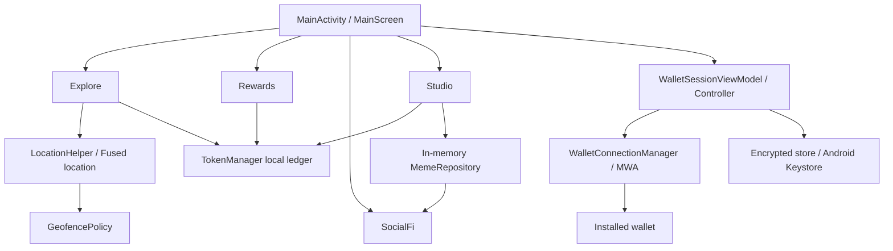

# Architecture — UI07

## Android application

`com.pulse.mobile.MainActivity` is the MAIN/LAUNCHER activity for application ID `com.pulse.mobile`. It initializes the demo ledger and MWA adapter, applies the Compose theme and hosts `MainScreen`. Four composable tabs share existing state. The radar is Canvas-based. There is no WebView, hosted frontend, tile service or application backend.

## Wallet

`WalletSessionController` coordinates loading, authorization, binding confirmation, persistence and disconnect. A ViewModel retains the controller across configuration recreation. A saved address alone never establishes Connected.

`WalletConnectionManager` assigns the saved token to `MobileWalletAdapter.authToken` before `connect`; the pinned SDK chooses the supported authorization protocol. The latest returned grant/account/provider metadata are persisted before Connected. A changed binding requires confirmation. Ordinary Activity termination cancels work rather than disconnecting. Explicit Disconnect clears local restoration state and attempts SDK revocation.

`AndroidWalletSessionStore` provides a Keystore AES key to `EncryptedWalletSessionStore`. AES-256-GCM protects authorization metadata in an atomic file under `noBackupFilesDir`. Backup is disabled and explicit extraction rules exclude stores. Tokens are not placed in SharedPreferences, UI or app logs. Hardware-backed key attestation is not verified.

The generic chooser after a new adapter is an acknowledged routing limitation. The official [Android guide](https://docs.solanamobile.com/android-native/using_mobile_wallet_adapter) documents restoring `authToken`; consult the [pinned SDK](https://github.com/solana-mobile/mobile-wallet-adapter/blob/v2.2.0/android/clientlib-ktx/src/main/java/com/solana/mobilewalletadapter/clientlib/MobileWalletAdapter.kt) for implementation details.

## GPS and check-in

An explicit user action requests location. `HotspotConfig` creates the test center from that permitted fix, never from invented committed coordinates. `LocationHelper` handles permission, cancellation and unavailable/timeout cases. `DemoHotspot` computes real geodesic distance. `GeofencePolicy` rejects mock-flagged, stale (>30 seconds), invalid and inaccurate (>30 m) fixes. Distance plus reported accuracy must fit inside the 100 m radius.

One preferences commit persists the claimed flag, receipt points/time, points, XP and counters. A shared GPS request gate prevents overlapping requests; a reset generation rejects stale callbacks. The mission flag survives hotspot removal, navigation and process restart. Only confirmed debug Reset deliberately makes it repeatable.

## Local rewards and creations

`TokenManager` owns `pulse_points_demo` preferences. Daily claim uses a UTC date guard. Tiers/multipliers are local. `DemoMemeRepository.kt` defines in-memory `MemeRepository`: content disappears on process death, while awarded points/XP/counters persist.

SocialFi contains sample fixtures and local memes. Likes are transient; local meme point spending debits this ledger without paying another wallet. Debug Developer Demo Tools confirm before clearing demo preferences and local memes, leaving wallet storage untouched. The release source set supplies a stub; finalization does not build a release.
